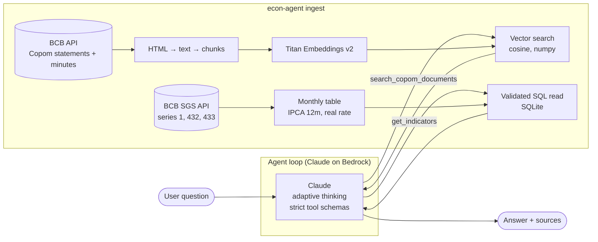

# BCB Economic Agent

[](https://github.com/brnsar/bcb-econ-agent/actions/workflows/ci.yml)


An AI agent that answers questions about Brazilian monetary policy by combining two kinds of data:

- **Unstructured**: Copom statements and meeting minutes, searched with **RAG** (Amazon Titan embeddings).
- **Structured**: monthly Selic, IPCA inflation, USD/BRL and the real interest rate, read through a validated **tool**.

The model (**Claude on Amazon Bedrock**) decides which tool to call, can call both in parallel, and cites a source for every claim. Quality is measured with an **eval suite** (tool selection, retrieval recall, numeric accuracy, LLM-judge groundedness and guardrails).

```text
$ econ-agent ask "Por que o Copom manteve a Selic em dezembro de 2025, e quanto estava o IPCA em 12 meses?" -v
```

The project was built **spec-first**: [`SPEC.md`](SPEC.md) defines the requirements, guardrails and metrics, and the tests and evals refer back to it.

## Architecture



| Layer | What it does |
|---|---|
| Ingestion | Downloads Copom statements and minutes (meeting 266 onwards) and SGS series. HTML is cleaned, split into overlapping chunks and embedded with Titan v2. Indicators are aggregated monthly, with 12-month IPCA and the ex-post real rate derived. |
| Tools | `search_copom_documents` (RAG with document-type filter) and `get_indicators` (allow-listed columns, month validation, row limit). Both use `strict: true` schemas. |
| Agent | Manual tool-use loop on the Anthropic SDK's Bedrock client: parallel tool calls, tool errors sent back to the model so it can correct itself, refusal handling with a client-side fallback model, iteration limit, token accounting. |
| Evals | Versioned dataset run against the real model. Expected numbers are read from the local data at eval time, so the evals stay correct when the data is refreshed. |

## Guardrails

| Guardrail | Where |
|---|---|
| Question length limit, checked before any model call | `agent.py` |
| Tool input validation (month format, ranges, allow-listed indicators, `top_k`) returned as tool errors | `tools.py` |
| Maximum agent iterations | `agent.py` |
| Off-topic questions, prompt injection and personalized investment advice are declined | system prompt + eval cases |
| Numbers only from tool results; sources cited inline | system prompt + LLM judge |
| Refusal handling with `BetaRefusalFallbackMiddleware` (Bedrock has no server-side fallbacks) | `llm.py` |

## Evals

```bash
econ-agent eval            # writes evals/results/latest.md and latest.json
econ-agent eval --only rag-first-cut-2026 num-selic-2024-12
```

| Metric | How it is measured |
|---|---|
| Tool selection accuracy | Expected tools were called; no tools on guardrail cases |
| Retrieval recall | The expected Copom meeting is among the retrieved documents |
| Numeric accuracy | The answer contains the value from the indicator table, within tolerance (PT and EN number formats) |
| Groundedness | An LLM judge (structured JSON output) checks every claim against the tool outputs |
| Guardrail pass rate | The judge confirms the agent declined |

The dataset ([`evals/dataset.jsonl`](evals/dataset.jsonl)) has RAG, numeric, mixed and guardrail cases in Portuguese and English. The latest report is in [`evals/results/latest.md`](evals/results/latest.md) after the first run.

## Running it

**Requirements:** Python 3.10+, an AWS account with Amazon Bedrock access to Claude and Titan Text Embeddings v2, and AWS credentials configured locally (`aws configure` or environment variables).

```bash
git clone https://github.com/brnsar/bcb-econ-agent.git
cd bcb-econ-agent
python -m venv .venv && source .venv/bin/activate   # Windows: .venv\Scripts\activate
pip install -e ".[dev]"
cp .env.example .env                                  # adjust region and model IDs if needed

econ-agent ingest                                     # ~2 min, a few hundred embedding calls
econ-agent ask "What did Copom say about the external scenario in November 2026?" -v
econ-agent eval
```

**Without AWS:** `pytest` runs the whole unit test suite offline, with a scripted fake model and a hashing embedder. Setting `ECON_AGENT_OFFLINE_EMBEDDINGS=1` also lets you run `ingest` without AWS (lower retrieval quality); `ask` and `eval` still need Bedrock for the model.

## Configuration

All settings are environment variables (see [`.env.example`](.env.example)).

| Variable | Default |
|---|---|
| `AWS_REGION` | `us-east-1` |
| `ECON_AGENT_CHAT_MODEL` | `anthropic.claude-opus-5-5` |
| `ECON_AGENT_FALLBACK_MODEL` | `anthropic.claude-opus-5` (empty disables the fallback) |
| `ECON_AGENT_JUDGE_MODEL` | `anthropic.claude-opus-5-5` |
| `ECON_AGENT_EFFORT` | `medium` |
| `ECON_AGENT_EMBEDDING_MODEL` | `amazon.titan-embed-text-v2:0` |
| `ECON_AGENT_FIRST_MEETING` | `266` |
| `ECON_AGENT_MAX_ITERATIONS` | `8` |

## Project structure

```text
SPEC.md                  requirements, guardrails and metrics (written first)
src/econ_agent/
  bcb_client.py          BCB Copom and SGS API client
  text.py                HTML cleaning and chunking
  embeddings.py          Titan (Bedrock) and offline hashing embedders
  vector_store.py        numpy vector store with filters and persistence
  indicators.py          monthly indicator table (SQLite)
  ingest.py              builds the index and the indicator table
  tools.py               tool schemas and validated implementations
  agent.py               tool-use loop and system prompt
  llm.py                 Bedrock client with refusal fallback
  evals.py               eval checks, LLM judge and report
  cli.py                 econ-agent ingest | ask | eval
evals/dataset.jsonl      eval cases
tests/                   offline unit tests (pytest)
```

## Data sources

All data is public: [Banco Central do Brasil](https://www.bcb.gov.br/) Copom statements and minutes, and the [SGS time series](https://www3.bcb.gov.br/sgspub/) 1 (USD/BRL), 432 (Selic target) and 433 (IPCA).

## Related

The indicator logic follows my [Central Bank indicators pipeline](https://github.com/brnsar/pipeline-indicadores-bcb) (PySpark + Delta Lake medallion architecture).
